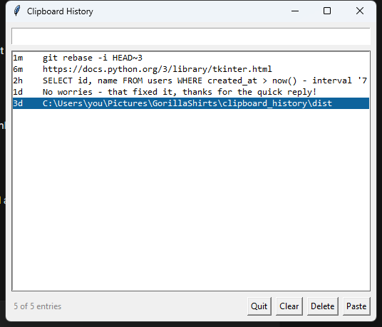

# Clipboard History


A tiny, fast clipboard manager for Windows that lives in the background and stays out of your way.

Press **Ctrl + Shift + V** anywhere, start typing, hit Enter — the thing you copied three hours ago is pasted into whatever window you're in.



---

## Why

Windows only remembers one copied item. Clip something else and the previous one is gone forever. This keeps the last **200** entries, lets you search them by substring, and pastes the one you want back with a single global hotkey. No tray icon, no account, no cloud, no telemetry — a single 13 MB `.exe` and a JSON file.

## Features

- **Global hotkey** — opens at your mouse cursor from any application
- **Instant search** — type to filter, results update as you type
- **One-key paste** — `Enter` copies the entry and pastes it into the window behind the popup
- **Timestamps** — see how old each entry is (`now`, `4m`, `2h`, `3d`)
- **Duplicates collapse** — copying the same text twice keeps one entry and bumps it to the top
- **Ignore list** — keep secrets out of history with substring rules
- **Size limits** — configurable entry count and max characters per entry
- **Fast** — polls the clipboard every 400 ms, no polling loops you can feel
- **Self-healing** — atomic writes, corrupt history files are discarded instead of crashing, and a missing `config.json` falls back to sensible defaults
- **Single instance** — launching it twice tells you rather than fighting over the hotkey
- **Zero dependencies to install** — the release build is self-contained

## Install

### Option 1 — grab the release (30 seconds)

1. Download `clipboard_history.exe` from the [latest release](https://github.com/harvs-phoenix/clipboard-history/releases/latest)
2. Put it anywhere you like (a folder in `%LOCALAPPDATA%` works well)
3. Double-click it

It runs immediately with no window — that's expected. Press **Ctrl + Shift + V**.

> **SmartScreen:** the exe isn't code-signed, so Windows may show *"Windows protected your PC"*. Click **More info → Run anyway**. That warning appears for every unsigned app, not just this one.

### Option 2 — build it yourself

Requires [Python 3.10+](https://www.python.org/downloads/) (tick *Add python.exe to PATH* during install).

```bat
git clone https://github.com/harvs-phoenix/clipboard-history.git
cd clipboard-history
build.bat
```

The result lands in `dist\clipboard_history.exe`. `build.bat` installs `pynput`, `keyboard` and `pyinstaller` for you, so you don't need to run `pip` by hand.

## Usage

| Key | Where | Does |
| --- | --- | --- |
| `Ctrl + Shift + V` | anywhere | Open the history popup at your cursor |
| `Enter` | search box | Paste the top / selected match |
| `↓` `↑` | search box | Move through the list |
| `Ctrl + 1` … `Ctrl + 9` | popup | Paste the *n*-th entry without touching the mouse |
| `Delete` | list | Remove the selected entry |
| `Esc` | popup | Dismiss without pasting |
| `Ctrl + Shift + Alt + Q` | anywhere | Quit the app |

The buttons in the footer do what they say. **Paste** pastes, **Delete** removes the selected entry, **Clear** wipes the whole history, **Quit** exits.

### Starting with Windows

Press `Win + R`, type `shell:startup`, press Enter, and drop a shortcut to `clipboard_history.exe` in that folder. Done — it now starts with your session and quietly records what you copy.

## Configuration

Settings live in `config.json` next to the executable. Edit it, then restart the app. Anything you leave out falls back to the default, so a partial file is fine — and if you delete it entirely the app still works.

```json
{
  "clipboard": {
    "enabled": true,

    "hotkey": "ctrl+shift+v",
    "quit_hotkey": "ctrl+shift+alt+q",

    "max_items": 200,
    "max_chars": 20000,
    "ignore_if_contains": [],

    "auto_paste": true,
    "paste_delay_ms": 250,
    "poll_interval_ms": 400,

    "preview_chars": 120,
    "popup_width": 520,
    "popup_height": 420,
    "show_timestamps": true,

    "data_dir": ""
  }
}
```

| Key | Default | What it does |
| --- | --- | --- |
| `enabled` | `true` | Set `false` to make the exe a no-op |
| `hotkey` | `ctrl+shift+v` | Any `+`-separated combo, e.g. `ctrl+shift+space` |
| `quit_hotkey` | `ctrl+shift+alt+q` | Set `""` to disable |
| `max_items` | `200` | How many entries to keep |
| `max_chars` | `20000` | Truncate entries longer than this |
| `ignore_if_contains` | `[]` | Anything whose lowercase text contains one of these strings is never recorded — e.g. `["password", "2fa", "secret"]` |
| `auto_paste` | `true` | `false` = just copy to clipboard, don't send `Ctrl+V` |
| `paste_delay_ms` | `250` | How long to wait before sending the paste (raise it if pastes land early) |
| `poll_interval_ms` | `400` | Clipboard sampling rate |
| `preview_chars` | `120` | Characters shown per row |
| `popup_width` / `popup_height` | `520` / `420` | Popup size in pixels |
| `show_timestamps` | `true` | Show the age column |
| `data_dir` | `""` | Where history is stored. Empty = a `data` folder next to the exe, falling back to `%LOCALAPPDATA%\ClipboardHistory` if that isn't writable |

## Where your data lives

```
clipboard_history.exe
config.json                  <- your settings
data\
  clipboard_history.json     <- your history, plain UTF-8 JSON
  error.log                  <- only written if something goes wrong
```

History is a plain JSON array — open it in any editor, or delete it to start fresh. Old-format entries from earlier versions load fine.

### ⚠️ Read this before you use it

This tool records everything you copy. That is the entire point of it, and it is also the risk:

- **Do not use it if you copy passwords, API keys, tokens or card numbers.** It cannot tell the difference between a password and a paragraph of text.
- The `ignore_if_contains` list is a blunt substring filter, not a security control. It reduces the blast radius; it does not eliminate it.
- The history file is **not** encrypted. Anyone with access to your user account can read it.
- Treat the `data` folder the way you'd treat your browser history.

## How it works

| File | Role |
| --- | --- |
| `clipboard_app.py` | The whole app: clipboard watcher, storage, popup UI, hotkeys |
| `actions.py` | Shared helpers — config loading plus the action dispatcher (`app` / `url` / `hotkey` / `scroll` / `type`) used by the companion dock and radial-menu tools |
| `config.json` | Settings (see above) |
| `build.bat` | Builds `dist\clipboard_history.exe` with PyInstaller |

The watcher reads the clipboard through Tk's built-in `clipboard_get`, which costs nothing and raises for non-text content, so images are skipped automatically. Hotkey callbacks come in on the `keyboard` library's hook thread and are handed to Tk through a queue — Tk isn't thread-safe, so the main loop is the only thing that ever touches widgets. Saves are atomic (`write temp → rename`), so a crash mid-write can't corrupt your history.

## Requirements

- Windows 10 or 11
- Python 3.10+ **only if you build from source** — the release exe needs nothing

## License

[MIT](LICENSE) © harvs-phoenix
